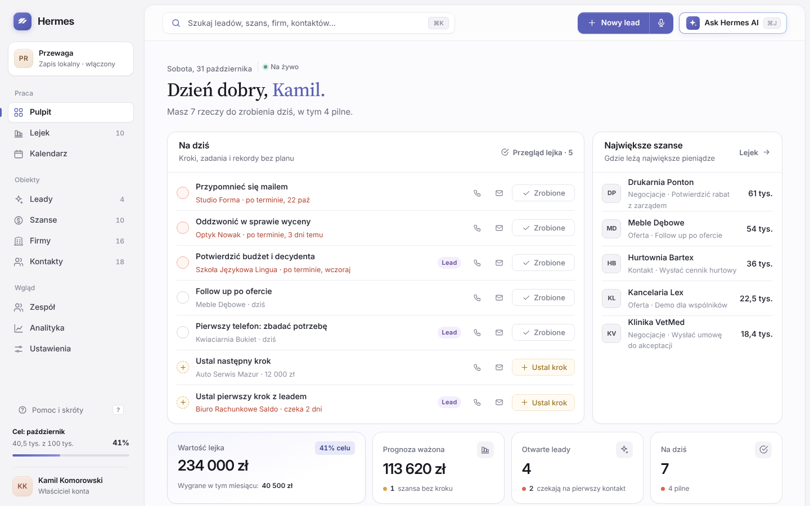

# Hermes CRM

[](https://github.com/kkomorowski125-projects/hermes_CRM/actions/workflows/tests.yml)

Prosty, AI-native CRM dla małych i średnich firm, zaprojektowany dla foundera, który sam sprzedaje. Hermes pilnuje, żeby każdy klient miał następny krok, a dane możesz dodawać głosem.



> **Status:** wersja 0.16 (umawianie spotkań przez link, design system 2.0): faza 1 [roadmapy](docs/roadmapa.md) gotowa technicznie, sześć z dziewięciu inicjatyw fazy 2 i pięć z ośmiu inicjatyw fazy 3 działa. Blokery, które wymagają decyzji, są wypisane w roadmapie. `index.html` działa samodzielnie jako prototyp z danymi w przeglądarce, a z serwerem z folderu `server/` jako aplikacja dla zespołu: konta, 2FA, role, synchronizacja, RODO i Hermes AI przez serwer.

## Szybki start

1. Pobierz repozytorium albo sam plik [`index.html`](index.html).
2. Otwórz `index.html` w Chrome, Edge albo Safari, najlepiej na komputerze.
3. Na Pulpicie kliknij **„Wczytaj dane demo”**, żeby zobaczyć Hermesa z przykładowym lejkiem, albo przejdź listę **„Zacznij tutaj”** z własnymi danymi.

Nie trzeba niczego instalować. Do pracy nad kodem i testów potrzebujesz Node.js 22 lub nowszego ([CONTRIBUTING.md](CONTRIBUTING.md)).

### Na Macu, jak zwykła aplikacja

Pobierz `Hermes-CRM-<wersja>-macOS.zip`, rozpakuj i uruchom w Terminalu `bash "Zainstaluj Hermes CRM.command"`. Instalator dodaje aplikację Hermes CRM, uruchamia ją w tle po zalogowaniu i trzyma dane tylko na tym komputerze. Szczegóły: [instalacja na Macu](docs/instalacja-mac.md); archiwum zbudujesz poleceniem `bash tools/build-installer.sh`.

### Z serwerem, dla zespołu

```bash
cp .env.example .env
docker compose up -d --build      # http://localhost:3000
```

Albo bez Dockera: `cd server && npm install && npm run dev` (baza SQLite w pliku). Pierwsze konto zakłada firmę i zostaje administratorem, resztę zespołu zapraszasz w Ustawieniach. Szczegóły: [serwer](docs/serwer.md) i [wdrożenie](docs/wdrozenie.md).

## Co potrafi

| Obszar | Najważniejsze funkcje |
| --- | --- |
| Leady i szanse | Osobne obiekty: lead to potencjalny klient, szansa to klient w procesie sprzedaży. Konwersja z checklistą ICP i zainteresowania, odrzucenie z powodem. |
| Następny krok i zadania | Każdy otwarty lead i szansa ma krok z terminem; zamknięcie wymusza kolejny. Do tego dowolnie wiele zadań z terminem i osobą, lista „Na dziś” i poranny plan mailem. |
| Karty rekordów | Pełny ekran jak w HubSpocie czy Pipedrive: pasek etapów, kluczowe liczby, firma i wiele kontaktów, aktywności z wynikiem rozmowy, oś czasu z filtrami. |
| Oferty i automatyzacje | Katalog produktów, pozycje w szansie z rabatem i VAT, oferta z linkiem do akceptacji online, reguły tworzące zadania i przydzielające leady, webhooki dla Zapiera i Make. |
| Lejek | Kanban szans z edytowalnymi etapami i prostszy kanban leadów, przeciąganie, filtr opiekuna. |
| Hermes Voice | Dodawanie firmy, kontaktu, leada i szansy głosem, także wszystko naraz, z podglądem przed zapisem. |
| Hermes AI | Plan dnia, zagrożone szanse, kolejność leadów, podsumowania i szkice maili. Działa lokalnie albo z kluczem Claude API. |
| Analityka | Okresy od dnia do roku, porównanie z poprzednim okresem, prognoza ważona, układ modułów do przeciągania. |
| Wyszukiwarka | Grupowane wyniki z podświetleniem, zakresy, klawiatura, szukanie po telefonach, emailach i historii. |
| Zespół | Konta z logowaniem (email, Google, Microsoft) i 2FA, zaproszenia mailem, zaproszenia, role (administrator, handlowiec, podgląd), widoczność „tylko swoje”, cele, dziennik zmian. Bez serwera: profile handlowców jako etykiety. |
| Dane | Maile w historii przez BCC, import z Pipedrive, HubSpot i Livespace, formularz leada na stronę i webhook, dane firmy po NIP z rejestru MF, import i eksport CSV z dopasowaniem kolumn, kopia zapasowa JSON, dane demo, cofanie operacji. Na serwerze: synchronizacja zmian między osobami, eksport i usunięcie danych osoby (RODO). |

Szczegóły i zrzuty ekranu są w [przewodniku użytkownika](docs/przewodnik.md).

## Dokumentacja

| Dokument | Dla kogo |
| --- | --- |
| [Stan projektu](docs/stan-projektu.md) | Co jest gotowe, otwarte sprawy i jak wrócić do pracy |
| [Przewodnik użytkownika](docs/przewodnik.md) | Jak pracować w Hermesie, ekran po ekranie |
| [Architektura](docs/architektura.md) | Jak zbudowana jest aplikacja i jak dodać funkcję |
| [Serwer](docs/serwer.md) | API, role, synchronizacja, RODO, bezpieczeństwo |
| [Instalacja na Macu](docs/instalacja-mac.md) | Instalator macOS: aplikacja, usługa w tle, dane, aktualizacja |
| [Wdrożenie](docs/wdrozenie.md) | Docker Compose, zmienne, HTTPS, kopie bazy |
| [Model danych](docs/model-danych.md) | Obiekty, pola, relacje, zapis i migracje |
| [Import i eksport](docs/import-eksport.md) | Formaty CSV, kolumny, kopia zapasowa |
| [Hermes AI](docs/hermes-ai.md) | Tryb lokalny, Claude API, bezpieczeństwo klucza |
| [Hermes Voice](docs/hermes-voice.md) | Rozpoznawanie mowy i reguły parsera |
| [Design system](docs/design-system.md) | Kolory, typografia, komponenty, zasady pisania |
| [Testy](docs/testy.md) | Jak uruchomić i pisać testy |
| [Roadmapa](docs/roadmapa.md) | Fazy, priorytety i metryki do wersji komercyjnej |
| [Historia zmian](CHANGELOG.md) | Co zmieniło się w kolejnych wersjach |

## Skróty klawiszowe

| Skrót | Akcja |
| --- | --- |
| `⌘K` / `Ctrl+K` / `/` | Wyszukiwarka |
| `⌘J` / `Ctrl+J` | Ask Hermes AI |
| `V` | Dodaj głosem |
| `N` | Nowy rekord (lead na Pulpicie, szansa w Lejku szans) |
| `⌘↵` / `Ctrl+Enter` | Zapisz wpis w historii |
| `Esc` | Zamknij okno lub panel; na karcie rekordu wróć do listy |

## Struktura repozytorium

```
index.html          cała aplikacja: HTML, CSS i JavaScript
server/             serwer API (Fastify, TypeScript, PostgreSQL lub SQLite) i jego testy
Dockerfile          obraz z serwerem i aplikacją; docker-compose.yml dodaje PostgreSQL
docs/               dokumentacja i zrzuty ekranu (docs/img)
tests/              testy w jsdom, uruchamiane przez npm test
installer/macos/    skrypty instalatora i deinstalatora dla macOS z instrukcją
tools/              sprawdzenie składni, zrzuty ekranu, budowanie instalatora
.github/            CI (GitHub Actions) i szablony zgłoszeń
```

## Technologia

Jeden plik HTML z czystym JavaScriptem, bez frameworka i bez zależności w przeglądarce. Dane w `localStorage`, fonty Inter i Source Serif 4 z Google Fonts. Rozpoznawanie mowy przez Web Speech API przeglądarki. Serwer: Node.js 22, Fastify 5, TypeScript, PostgreSQL 16 albo wbudowany SQLite. Testy w Node.js z jsdom i `node:test`, uruchamiane w GitHub Actions przy każdym pushu na obu bazach.

## Ograniczenia

- Bez serwera dane są tylko w tej przeglądarce, a klucz Claude API jest trzymany lokalnie; to tryb prototypu.
- Brak płatności oraz integracji z Gmailem, Outlookiem i kalendarzami (kolejne etapy roadmapy).
- Aplikację na telefon instaluje się z przeglądarki (PWA); natywna aplikacja jest w fazie 4.
- Rozpoznawanie mowy zależy od przeglądarki; Firefox go nie obsługuje.

## Licencja

Wszelkie prawa zastrzeżone. Kod jest publicznie widoczny w celach poglądowych; użycie komercyjne wymaga zgody autora.
