# Przewodnik użytkownika

Hermes prowadzi Cię przez sprzedaż od pierwszego kontaktu do wygranej. Ten przewodnik opisuje każdy ekran i najważniejsze zasady pracy.

## Spis treści

1. [Pierwsze uruchomienie](#pierwsze-uruchomienie)
2. [Jak myśli Hermes: leady i szanse](#jak-myśli-hermes-leady-i-szanse)
3. [Pulpit i lista „Na dziś”](#pulpit-i-lista-na-dziś)
4. [Następny krok](#następny-krok)
5. [Lejek szans i lejek leadów](#lejek-szans-i-lejek-leadów)
6. [Listy obiektów](#listy-obiektów)
7. [Karta leada i karta szansy](#karta-leada-i-karta-szansy)
8. [Firmy i kontakty](#firmy-i-kontakty)
9. [Dodawanie rekordów i głos](#dodawanie-rekordów-i-głos)
10. [Wyszukiwarka](#wyszukiwarka)
11. [Analityka](#analityka)
12. [Hermes AI](#hermes-ai)
13. [Ustawienia](#ustawienia)
14. [Cofanie i bezpieczeństwo danych](#cofanie-i-bezpieczeństwo-danych)

## Pierwsze uruchomienie

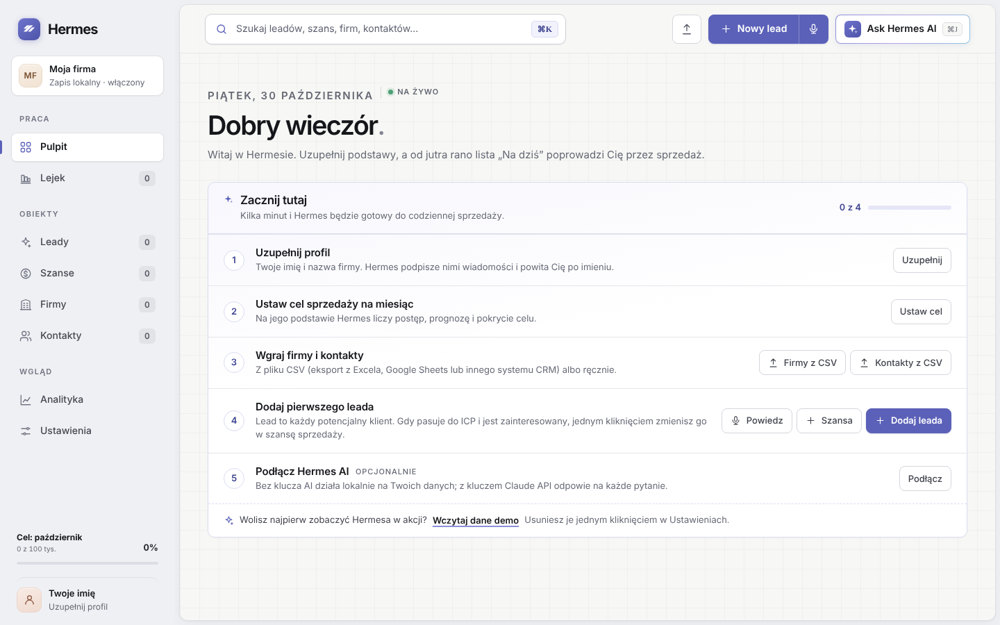

Hermes startuje pusty. Lista **„Zacznij tutaj”** na Pulpicie prowadzi przez pięć kroków:

1. **Profil:** imię i nazwa firmy. Hermes podpisuje nimi szkice wiadomości i ustawia Cię jako opiekuna nowych rekordów.
2. **Cel sprzedaży na miesiąc:** podstawa postępu, prognozy i pokrycia celu.
3. **Firmy i kontakty:** z pliku CSV albo ręcznie.
4. **Pierwszy lead:** ręcznie, głosem albo jako szansa.
5. **Hermes AI** (opcjonalnie): klucz Claude API.

Chcesz najpierw zobaczyć aplikację w akcji? Kliknij **„Wczytaj dane demo”**. Usuniesz je w Ustawieniach przyciskiem „Wyczyść wszystko”.

## Jak myśli Hermes: leady i szanse

| | Lead | Szansa sprzedaży |
| --- | --- | --- |
| Kto to | Każdy potencjalny klient | Klient w procesie sprzedaży, który pasuje do ICP i jest zainteresowany |
| Etapy | Nowy, W kontakcie, Kwalifikacja | Edytowalne etapy lejka (domyślnie Nowe, Kontakt, Oferta, Negocjacje) |
| Zamknięcie | Konwersja na szansę albo odrzucenie z powodem | Wygrana albo przegrana z powodem |
| Wartość | Szacowana | Wartość i prognoza ważona |

**Konwersja** wymaga zaznaczenia, że klient pasuje do ICP i jest zainteresowany. Szansa przejmuje firmę, wszystkie kontakty i historię leada, a lead dostaje status „Skonwertowany” z linkiem do szansy.

## Pulpit i lista „Na dziś”

Pulpit pokazuje wartość lejka z postępem celu, prognozę ważoną, otwarte leady i liczbę zadań na dziś.

Lista **„Na dziś”** zbiera:

- kroki z terminem na dziś i po terminie (czerwone), z leadów i szans;
- rekordy bez zaplanowanego kroku (żółte kółko z plusem);
- nowe leady, które czekają na pierwszy kontakt.

Kliknięcie kółka zamyka zadanie, a kliknięcie tytułu otwiera kartę rekordu.

## Następny krok

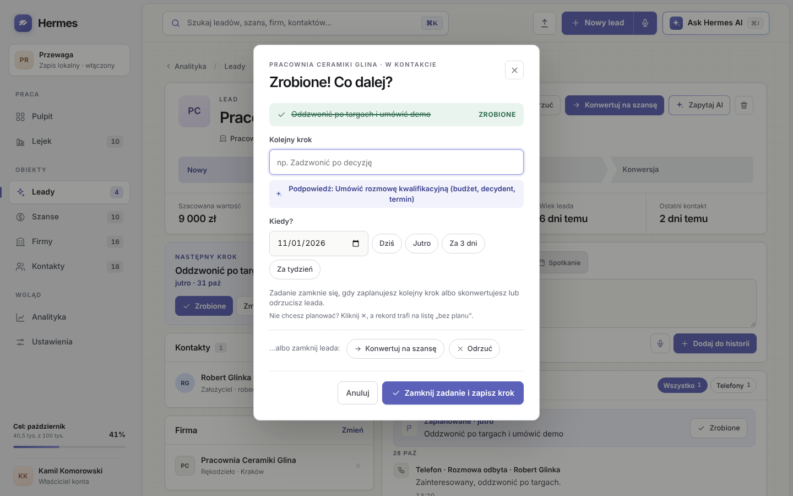

To serce Hermesa. Każdy otwarty lead i każda otwarta szansa ma krok z terminem.

- **„Zrobione”** zamyka bieżący krok i od razu prosi o kolejny. Hermes podpowiada krok pasujący do etapu.
- Zamiast kolejnego kroku możesz zamknąć rekord: szansę jako wygraną lub przegraną, leada przez konwersję lub odrzucenie.
- Okno nie zamyka się przez kliknięcie obok ani klawisz Esc. Krok możesz **świadomie pominąć krzyżykiem ✕**. Rekord trafia wtedy na listę „bez planu”, a w historii zostaje ślad.
- Ta sama zasada działa przy zmianie etapu lub statusu. Zmianę można cofnąć przyciskiem „Cofnij zmianę etapu”.

## Lejek szans i lejek leadów

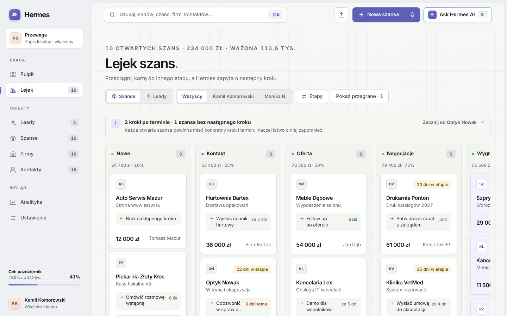

**Lejek szans** to kanban z kolumną na każdy etap. Kolumna pokazuje sumę wartości i prawdopodobieństwo etapu, a karta pokazuje następny krok i oznaczenie szans stojących w etapie 14 dni lub dłużej. Przeciągnięcie karty do innej kolumny zmienia etap i pyta o następny krok. Przycisk **„Etapy”** prowadzi do edycji etapów.

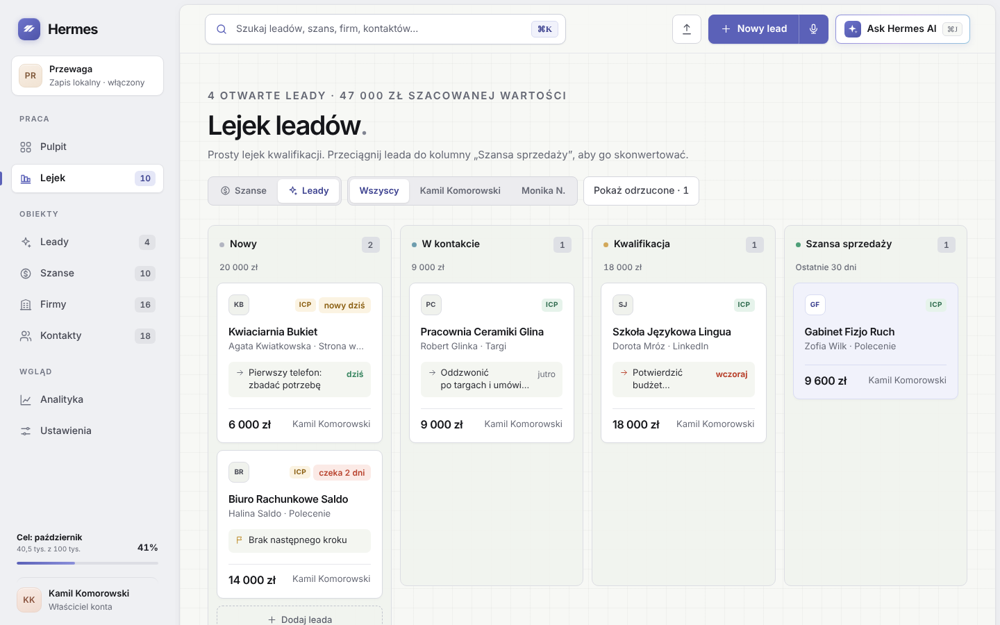

**Lejek leadów** włączasz przełącznikiem „Szanse / Leady”. Kolumny to Nowy, W kontakcie, Kwalifikacja i Szansa sprzedaży (konwersje z 30 dni). Karta pokazuje ocenę ICP i czas czekania na pierwszy kontakt. Przeciągnięcie do kolumny „Szansa sprzedaży” otwiera konwersję, a odrzucone leady pokażesz przyciskiem.

Gdy w zespole jest więcej niż jedna osoba, oba lejki mają filtr opiekuna.

## Listy obiektów

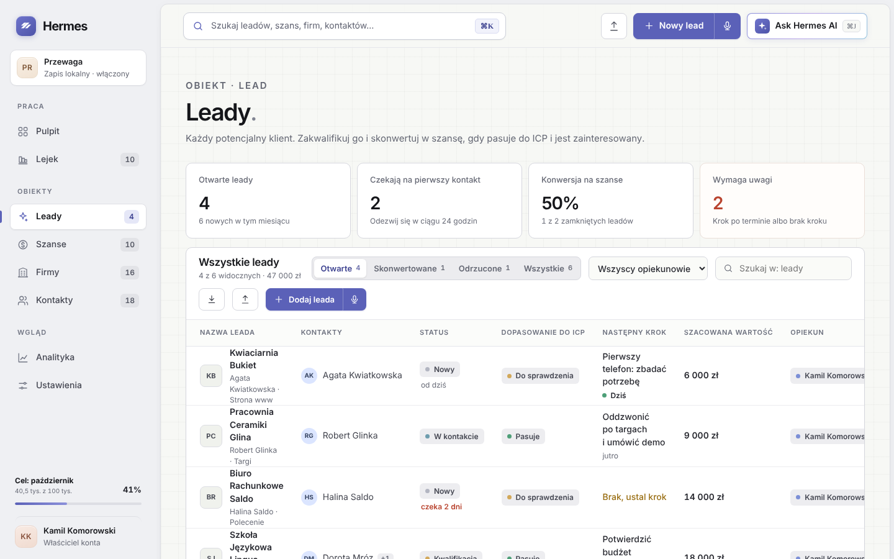

Każdy obiekt (Leady, Szanse, Firmy, Kontakty) ma listę z:

- podsumowaniem w czterech kafelkach, z czwartym „wymaga uwagi”;
- filtrami: otwarte, skonwertowane, odrzucone, wygrane, przegrane, cisza 30+ dni;
- sortowaniem po kliknięciu w nagłówek kolumny (rosnąco, malejąco, bez sortowania);
- wyszukiwarką w obrębie listy i filtrem opiekuna;
- eksportem i importem CSV oraz przyciskiem dodawania z mikrofonem.

Na liście leadów status „Nowy” pokazuje, ile dni lead czeka na pierwszy kontakt.

## Karta leada i karta szansy

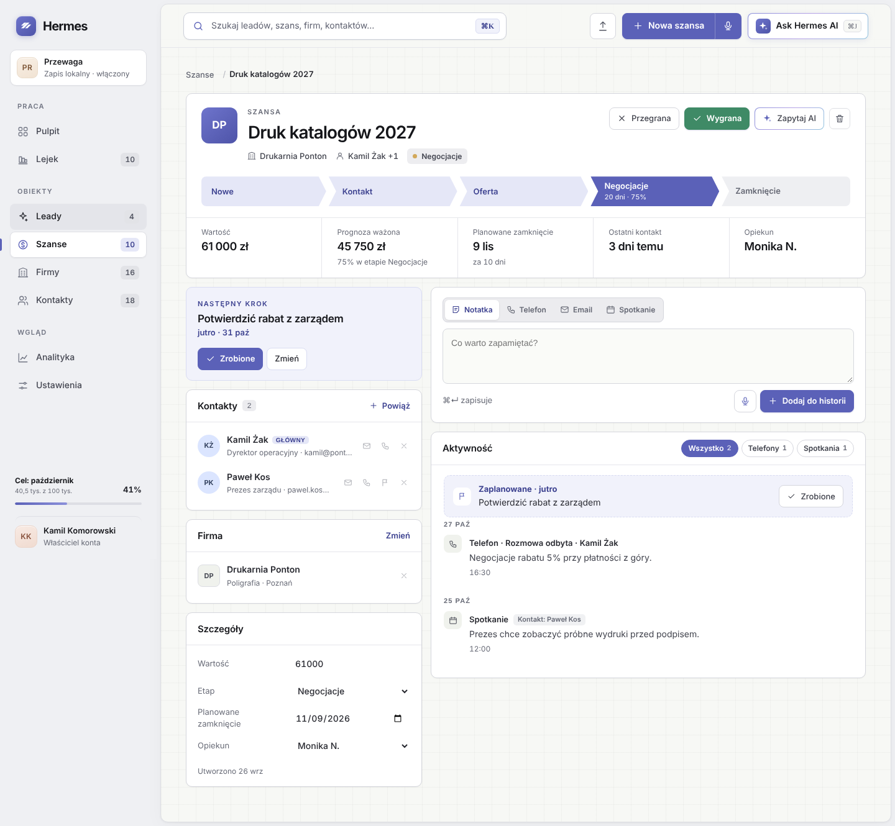

Kliknięcie leada lub szansy w dowolnym miejscu otwiera pełny ekran rekordu.

**Nagłówek:** nazwa (edytujesz ją, klikając), firma, główny kontakt, etap lub status, akcje Wygrana / Przegrana albo Konwertuj / Odrzuć, Zapytaj AI i Usuń. Pod nim klikalny pasek etapów i kluczowe liczby.

**Lewa kolumna:**

- **Następny krok** z przyciskami „Zrobione” i „Zmień”.
- **Kontakty:** dowolna liczba osób. Przycisk „Powiąż” otwiera wyszukiwarkę, w której możesz też utworzyć nową osobę. Hermes podpowiada osoby z tej samej firmy, a kontakt główny ustawiasz flagą. Odłączenie można cofnąć.
- **Firma:** powiązanie, zmiana lub odłączenie. Powiązanie kontaktu bez firmy uzupełnia firmę automatycznie.
- **Szczegóły:** wszystkie pola, także własne.
- **Powiązane rekordy:** źródłowy lead albo szansa z leada oraz inne rekordy tej firmy.

**Prawa kolumna:**

- **Dodawanie aktywności:** notatka, telefon, email, spotkanie. Przy telefonie wybierasz wynik rozmowy, a przy telefonie, emailu i spotkaniu osobę, z którą rozmawiałeś. Mikrofon pozwala dyktować treść.
- **Oś czasu** pogrupowana według dni, z filtrami. Na górze zaplanowany krok. Oś pokazuje też wpisy z kontaktów rekordu i ze źródłowego leada.

Pierwsza zapisana rozmowa z nowym leadem zmienia jego status na „W kontakcie”.

## Firmy i kontakty

Firmy i kontakty otwierają się w panelu bocznym. Panel zawiera dane do edycji, historię kontaktów i listę powiązanych leadów i szans. Przyciski **„Lead”** i **„Szansa”** tworzą nowy rekord od razu powiązany z tą firmą lub osobą. Historia firmy zbiera też wpisy jej kontaktów i szans.

## Dodawanie rekordów i głos

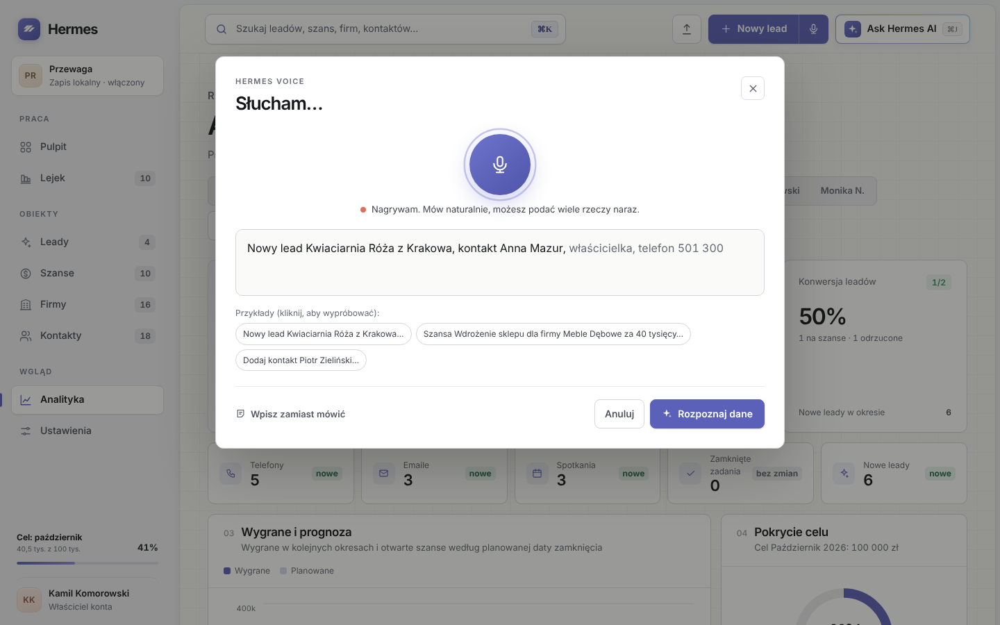

Przycisk dodawania w górnym pasku zmienia się zależnie od widoku: na Pulpicie dodaje leada, w Lejku szans szansę, na liście dany obiekt. Formularz leada i szansy od razu tworzy firmę i osobę kontaktową.

Ikona **mikrofonu** przy przycisku dodawania (albo klawisz `V`) otwiera Hermes Voice. Mówisz naturalnie, a Hermes rozpoznaje firmę, kontakt, leada i szansę, także wszystko naraz.

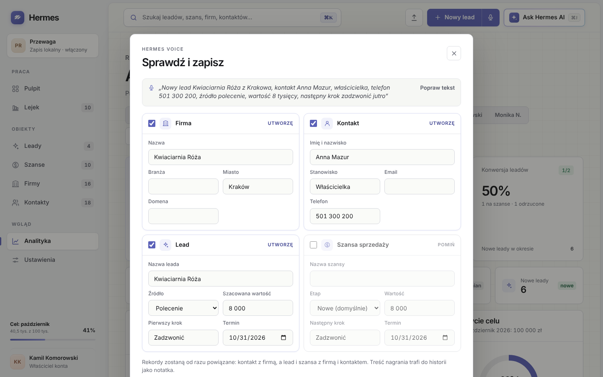

Przed zapisem widzisz karty z polami do poprawienia i informację, które rekordy już istnieją. Zapis wiąże wszystko ze sobą, a treść nagrania trafia do historii jako notatka. Szczegóły w [Hermes Voice](hermes-voice.md).

## Wyszukiwarka

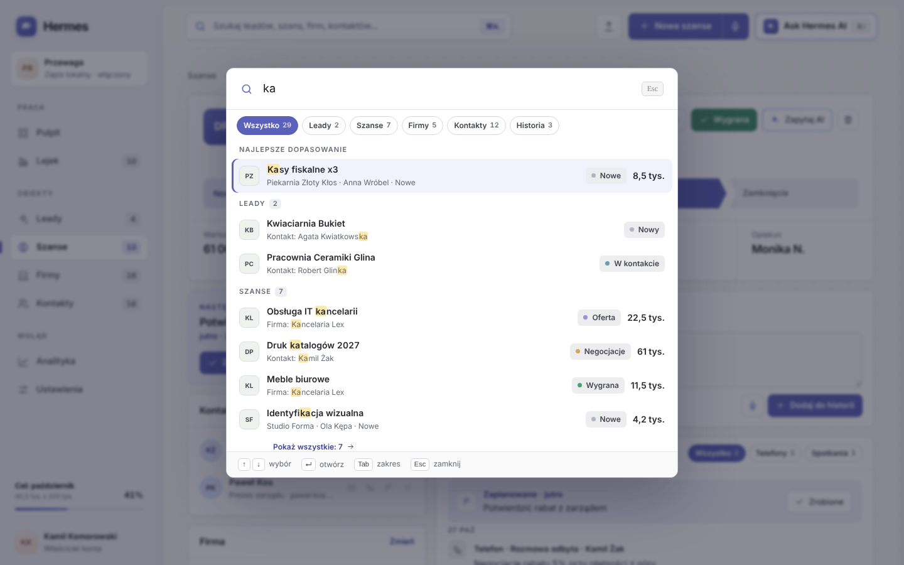

Otwierasz ją polem w górnym pasku, skrótem `⌘K` albo klawiszem `/`.

- Bez wpisanego tekstu pokazuje ostatnio otwierane rekordy, zadania na dziś, nawigację i szybkie tworzenie.
- Szuka w nazwach, firmach, osobach, emailach, telefonach, domenach, następnych krokach i historii notatek.
- Na górze jest najlepsze dopasowanie, niżej wyniki pogrupowane według obiektu, z podświetleniem trafienia, etapem lub statusem i kwotą.
- `↑` `↓` zmieniają wybór, `↵` otwiera, `Tab` przełącza zakres (Leady, Szanse, Firmy, Kontakty, Historia).
- „Pokaż wszystkie” rozwija grupę, a „Otwórz listę” przenosi wyszukiwanie na listę obiektu.
- Bez wyników proponuje utworzenie leada, firmy albo kontaktu z wpisaną nazwą.

## Analityka

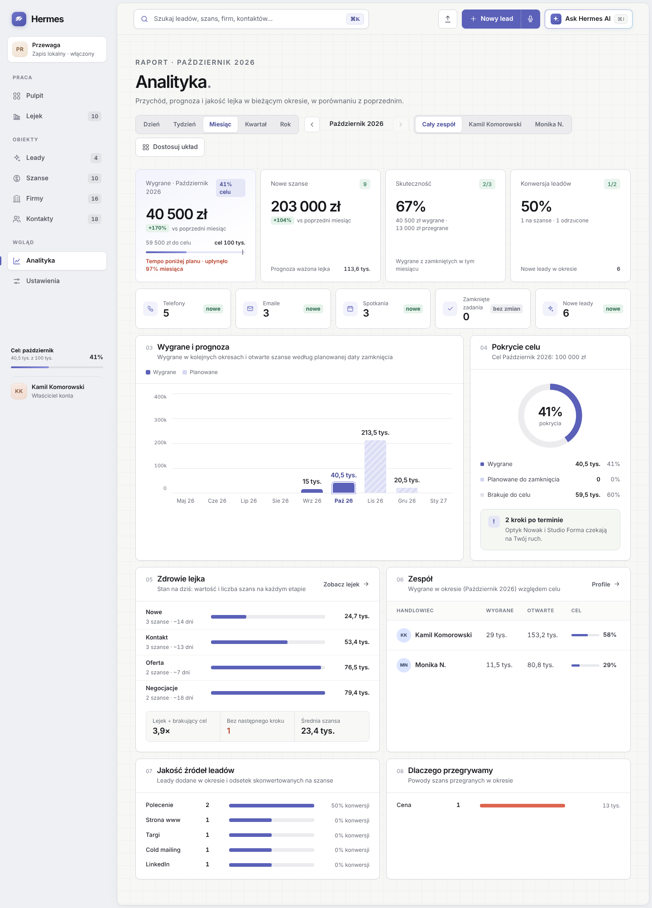

**Okresy:** dzień, tydzień, miesiąc, kwartał, rok. Strzałkami przechodzisz do poprzednich okresów, a „Bieżący” wraca do dziś. Każdy wynik jest porównany z poprzednim okresem.

**Cel okresu** wynika z celu miesięcznego: kwartał to trzy razy więcej, rok dwanaście, dzień i tydzień proporcjonalnie do liczby dni w miesiącu. W bieżącym okresie Hermes pokazuje tempo: czy wygrane nadążają za upływem czasu.

**Moduły:** wskaźniki sprzedaży, aktywność handlowa, wygrane i prognoza, pokrycie celu, zdrowie lejka (stan na dziś), zespół, jakość źródeł leadów, powody przegranych. Do dodania: lejek konwersji, najbliższe zamknięcia, leady według statusu.

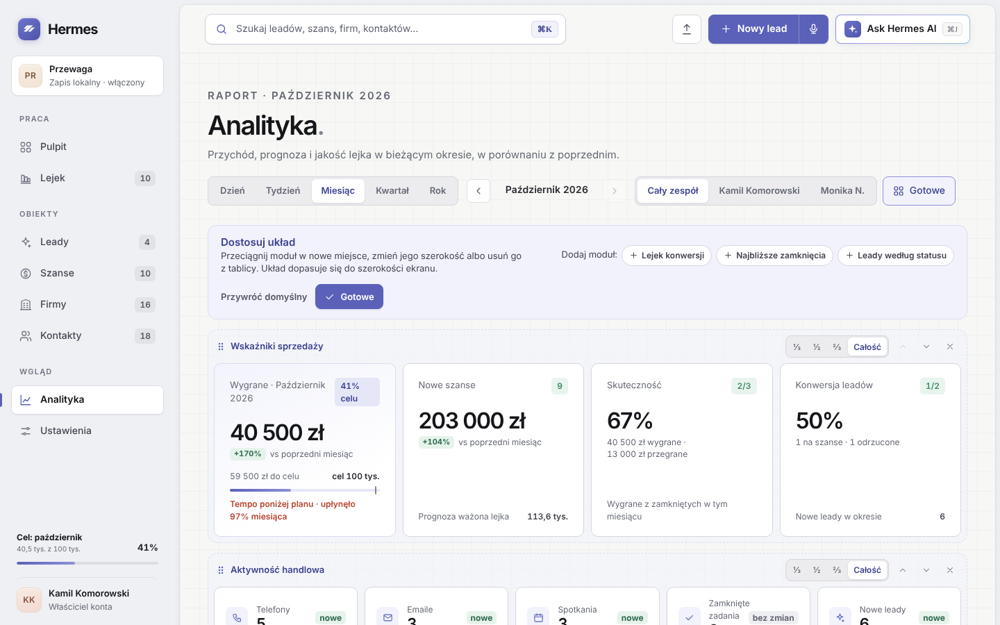

**„Dostosuj układ”** włącza tryb edycji: przeciągasz moduły, zmieniasz szerokość (⅓, ½, ⅔, całość), usuwasz je i dodajesz. Siatka sama wypełnia luki i dopasowuje się do szerokości ekranu. „Przywróć domyślny” wraca do startowego układu.

## Hermes AI

Przycisk **„Ask Hermes AI”** (`⌘J`) otwiera panel rozmowy. Na karcie rekordu AI dostaje jego kontekst.

Bez klucza Hermes AI działa lokalnie i rozumie pytania o plan dnia, zagrożone szanse, wyniki miesiąca, kolejność leadów, podsumowania rekordów, następne kroki i szkice maili. Z kluczem Claude API odpowiada na dowolne pytania o dane w CRM. Szczegóły w [Hermes AI](hermes-ai.md).

## Ustawienia

| Zakładka | Co tam jest |
| --- | --- |
| Ogólne | Profil, cel miesięczny, klucz Claude API i model, kopia zapasowa, eksport CSV, dane demo, czyszczenie danych |
| Zespół | Profile handlowców: imię, email, rola, cel indywidualny, otwarty lejek |
| Lejek | Etapy szans: nazwa, prawdopodobieństwo, podpowiedź kroku, kolejność, dodawanie i usuwanie |
| Leady, Szanse, Firmy, Kontakty | Zmiana nazw pól i własne pola (tekst, liczba, kwota, data, lista wyboru, email, telefon) |

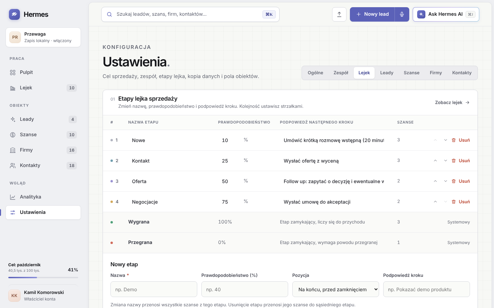

- Zmiana nazwy etapu przenosi wszystkie szanse razem z nią.
- Usunięcie etapu przenosi jego szanse do sąsiedniego etapu i można je cofnąć.
- Etapy „Wygrana” i „Przegrana” są stałe.
- Zmiana imienia handlowca przenosi się na wszystkie jego rekordy.
- Usunięcie profilu przekazuje jego rekordy właścicielowi konta.

## Cofanie i bezpieczeństwo danych

Usunięcie rekordu, odłączenie kontaktu lub firmy, odrzucenie leada, usunięcie etapu, profilu lub modułu, wczytanie danych demo i wyczyszczenie danych cofniesz z powiadomienia na dole ekranu (przez około 7 sekund). Zmianę etapu lub statusu cofasz w oknie następnego kroku.

Dane zapisują się automatycznie w tej przeglądarce. Wyczyszczenie danych przeglądarki je usuwa, dlatego regularnie pobieraj **kopię zapasową** w Ustawieniach.
